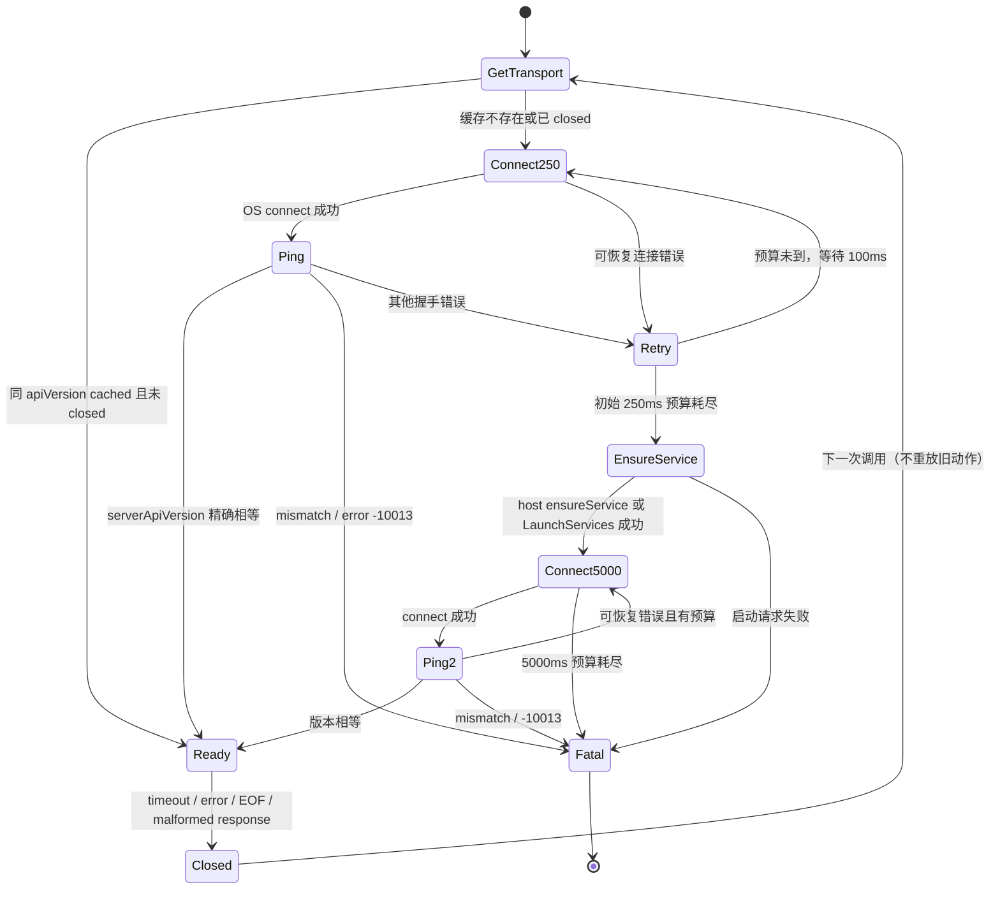
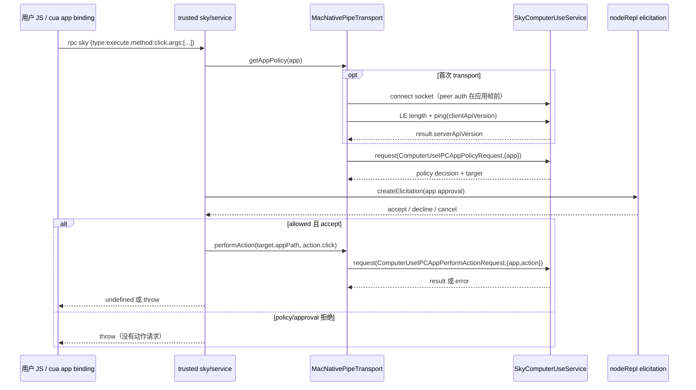

# mac native socket 状态机与业务时序

证据详解见 [协议报告](<02-protocol.md>)；源码见 [native transport](<raw/protocol/sky-native-pipe.js.readable.txt>)。下图不是在线成功抓包：线上只达到“connect 后被拒绝”；其余依据官方 JS。

## 连接生命周期（[JS源码]）



请求内部由 promise 链串行；队列等待不计入该 request 的 timeout/deadline；实际发送时计算绝对 deadline。pending map 按递增 number id 匹配。任一超时关闭整条连接并 reject 所有 pending；收到单个合法 JSON error 则只 reject 对应请求。

## 正常 public sky click（[JS源码]，未在线执行）



## 本次真实连接（[实测]）

```text
Python PID 57447          SkyComputerUseService PID 14867
       connect()  -------------------->
       CONNECT_OK <--------------------
                                       08:22:05.018 日志：
                                       Sender process is not authenticated
       recv() = b"" <------------------ EOF
       STOP（未 write ping）
```

见 [probe 日志](<raw/protocol/probe-socket-run.log>) 与 [认证日志:30](<raw/protocol/service-auth-log.txt#L30>)。OS connect 成功仅说明监听 socket 可达，不说明 peer 已获应用授权。
