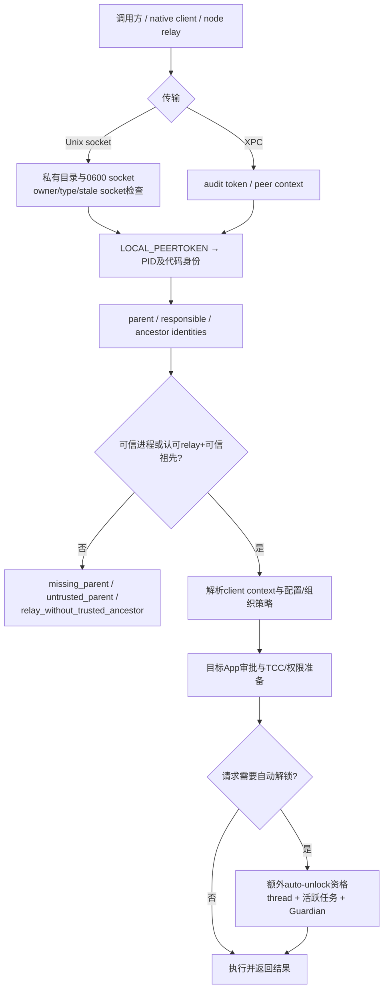
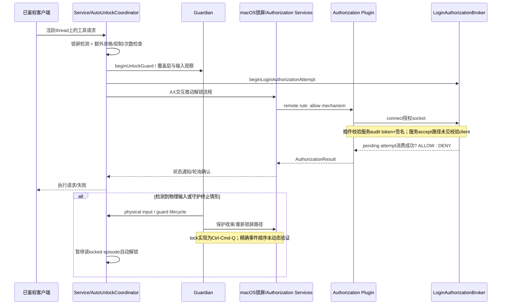

# Codex Computer Use：权限、客户端鉴权与锁屏安全模型

## 0. 范围、证据等级与结论

对象是本机 [Codex Computer Use.app](</Users/v1ki/.codex/computer-use/Codex Computer Use.app>)，版本 `26.1013.1001501`、identifier `com.openai.sky.CUAService`、TeamID `2DC432GLL2`。本报告仅做静态分析及已有状态/日志的只读采集；**没有连接业务 socket、调用工具、触发 TCC、锁屏/解锁、安装/卸载或更改 authorizationdb**。

证据标记：
- **[二进制]**：plist、签名、符号、反汇编中直接存在的事实；函数存在不等于运行过。
- **[字符串]**：字符串/文案/字段存在，除非另有调用链，不推定该分支执行。
- **[实测]**：本机已有文件、权限、authorizationdb、launchctl、日志的只读观察；不是主动功能试验。
- **[推测]**：基于上述事实的解释或风险，尚未动态证实。

主要结论：
1. **TCC 权限、客户端进程身份、目标 App 审批、组织/配置策略、锁屏自动解锁资格是不同层**，不能把其中任一层当成万能授权。
2. 普通 IPC 是用户私有目录中的 `0600` socket；服务还检查 sender/parent/responsible/ancestor 身份。**“同 UID 能 connect”不等于“任意第三方能使用 Computer Use”。**
3. 本机的 `system.login.screensaver` 确实改成自定义 remote 分支或 stock UI 分支任选一成功；不是仅“包含安装器”而未安装。
4. 锁屏授权 socket 是 `0666`。插件验证服务端签名，但服务的 accept→broker→ALLOW/DENY 路径未见对连接者身份的检查；值得专门审计单次授权抢消费/拒绝服务，**尚不能据此宣称绕过锁屏**。
5. 存在持久化 App 审批 JSON、四份会话 TOML、遥测传输器和 Statsig/Sparkle 配置。没有抓包或出站请求回放，不能把字符串域名清单当作已发生的数据外流。

原始证据位于 [security](<raw/security/>)；复现入口 [run.sh](<raw/security/run.sh>) 与派生脚本 [derive.py](<raw/security/derive.py>)。反汇编中的地址对应当前镜像，更新后不可直接复用。

## 1. 签名、容器与系统权限

### 1.1 身份与沙箱边界

[二进制] 服务的 designated requirement 约束 identifier、Apple generic anchor、Developer ID 证书链及 TeamID。entitlements 包含：

```text
com.apple.application-identifier = 2DC432GLL2.com.openai.sky.CUAService
com.apple.developer.team-identifier = 2DC432GLL2
com.apple.security.application-groups = [2DC432GLL2.com.openai.sky.CUAService]
com.apple.security.automation.apple-events = true
com.apple.security.personal-information.addressbook = true
com.apple.security.personal-information.calendars = true
keychain-access-groups = [2DC432GLL2.*]
```

没有看到 `com.apple.security.app-sandbox`。这些 entitlement **不是已经取得 TCC 同意的证明**；app group 也不是本地 socket 的完整鉴权机制。证据：[签名/entitlements](<raw/security/service.codesign.txt>)、[签名详情](<raw/security/service.signature-details.txt>)、[Info plist](<raw/security/service.info.txt>)。

### 1.2 权限矩阵

| 权限/门槛 | 已确认线索 | 触发/用途及失败语义 | 置信与限制 |
|---|---|---|---|
| Accessibility | `_AXIsProcessTrusted`、`AccessibilityPermission`、AX 树/动作、`SystemLockScreenAXInteractor` | 获取界面元素、点击/键盘等操作、锁屏 UI 交互。权限 coordinator 有检查/引导系统设置路径 | [二进制] 有代码；未主动撤销/授予测试 |
| Screen Recording | `_CGPreflightScreenCaptureAccess`、`_CGRequestScreenCaptureAccess`、`ScreenRecordingPermission` | `get_app_state` 截图、视觉状态；文案说明用截图定位点击位置 | [二进制][字符串] 未实际弹窗；plist 无专门用途文案不表示不需要此权限 |
| Apple Events / Automation | `NSAppleEventsUsageDescription`、automation entitlement、`_AEDeterminePermissionToAutomateTarget`；Messages/Calendar/Mail/OmniFocus permission 类型 | plist 明确说在收件人与消息内容批准后向 App 发消息；按目标 App 的 Automation 授权与 AX 不是同一门槛 | [二进制] 目标类型存在不表示本服务会主动请求全部 |
| Contacts | `NSContactsUsageDescription`、addressbook entitlement、`SystemContactSource.requestAccessIfNecessary()` | 名字、电话、邮箱解析消息接收者；拒绝后的具体 UI/错误未主动验证 | [二进制][字符串] |
| Calendar full access | `NSCalendarsFullAccessUsageDescription`、calendar entitlement、Calendar MCP 文案 | 读取、创建、更新、删除事件；邀请/更新可能通知参会人 | [二进制][字符串] 不等于用户已授权 |
| Full Disk Access | `FullDiskAccessPermission`、Messages 权限文案、`Library/Messages/chat.db` | 搜索 Messages 数据库所需；不是全局 Computer Use 的通用先决条件 | [二进制][字符串] 未读取消息 DB、TCC DB |
| Input Monitoring | `SystemLockScreenPhysicalInputMonitor`→`AccessibilitySupport.EventTap.events` | 观察物理输入以暂停自动解锁/触发保护 | [二进制] 没有独立证明一定需要或已授予 ListenEvent TCC；不能与 AX 混同 |
| Reminders / Location | 通用 SlimCore permission 类型 | 库中提供此能力 | [二进制] 本 App plist 未见对应用途说明，不能列为已请求权限 |
| 每 App 审批 | `AppApprovalStore`、MCP elicitation、`approvedBundleIdentifiers` | “允许一次/会话/持久化”的应用级策略；取消、拒绝、持久化失败有独立错误 | [字符串][实测] 不是 macOS TCC |
| 自动解锁资格 | `allowsLockScreenAutoUnlock`、thread ID、Guardian、active attempt | 可信请求不自动意味着允许解锁；缺 thread、物理输入、失败重试限制均可阻止 | [二进制][字符串] 未动态触发 |

符号证据：[demangled symbols](<raw/security/service.demangled.txt>)；用途与错误文案：[service strings](<raw/security/service.strings.txt>)。

**[实测] 间接 TCC 请求确实发生过。** 已有日志在 2026-10-29 08:01、08:15 出现 `TCCAccessRequestIndirect`，target identity 包含 `/Applications/ChatGPT.app/Contents/MacOS/ChatGPT`、identifier `com.openai.codex`、TeamID `2DC432GLL2`，返回 `result was 1, timeout was 0`。路径名与签名 identifier 不一致应照录，而非自行“修正”。日志未直接给出每次请求对应的完整 TCC service 名，不能由这些行认定全部权限已允许。静态导入中没检出该名字也不构成不存在的证明。证据：[日志节选](<raw/security/logs-excerpt.txt>)、[完整采集日志](<raw/security/logs.txt>)。

## 2. 客户端连接、签名与请求授权

### 2.1 传输和 OS 层访问

[实测] group container 与 `IPC` 目录权限为 `0700`、用户 `v1ki:staff`；`IPC/computeruse.sock` 和 lock file 为 `0600`。目录内有持久化 approvals 与 analytics 文件，但父目录保护使其中 `0644` 文件并不直接向其他普通用户开放。证据：[递归权限列表](<raw/security/ipc-listing.txt>)。

[二进制][字符串] 支持 JSON-RPC Unix socket、XPC，schema 还存在 Apple Event transport 枚举。普通 socket 实现包含：目录/文件 owner、类型、unsafe permissions、stale socket device/inode 改变、lock owner 等失败路径；peer identity 获取使用 `LOCAL_PEERTOKEN`。XPC 有 `_xpc_dictionary_get_audit_token`；代码身份解析使用 `SecCodeCopyGuestWithAttributes`、`SecCodeCopySigningInformation`、`SecCodeCopyStaticCode`、`SecTaskCreateWithAuditToken` 和 PID/祖先解析。

[实测] launchctl 快照出现 unmanaged `SkyComputerUseS.14867` 项，不足以推导为系统级常驻 LaunchDaemon。证据：[launchctl 摘要](<raw/security/launchctl-matches.txt>)、[完整 launchctl](<raw/security/launchctl.txt>)。

### 2.2 应用层身份策略

[二进制][字符串] `ComputerUseIPCSenderAuthorization` 与 `ComputerUseIPCSenderContextResolver` 记录 parent、responsible、ancestor identities，以及 clientType/mcpRuntime/foregroundOnly/codexManaged 等上下文。失败类别明确有 `missing_parent`、`untrusted_parent`、`relay_without_trusted_ancestor`。代码不只信任请求 JSON 自报的 bundle ID。

默认 senderAuthorization initializer `0x100047dc0` 引用两个静态 requirement；初始化函数 `0x10017f464` / `0x10017f570` 的静态数组解出：

| 静态初始化对象 | 内容 | 可下的结论 |
|---|---|---|
| 第一 requirement 的三个集合 | TeamIDs `2DC432GLL2`, `HX7739G8FX`；identifiers `node`, `node_repl`；executable names `node`, `node_repl` | [二进制] 明确存在 relay 候选白名单；不能据此说仅改文件名即可通过 |
| 第二 requirement | TeamID `2DC432GLL2`；另两集合为空 | [二进制] 可信进程的签名 Team 限制；需要与调用点/祖先语义一起解释 |
| 额外 requirement | `MQ55VZLNZQ` 与 `codex-acp` | [二进制] 另有适配身份；尚未证明所有传输都接受它 |

证据：[默认 initializer](<raw/security/auth-defaults-disassembly.txt>)、[相关实现](<raw/security/auth-disassembly.txt>)、[静态数组解码](<raw/security/auth-static-arrays.txt>)。上述集合的逐字段布尔组合、responsible identity 的回退与最大祖先深度尚未全部还原，故不将此表包装成完整可执行 allowlist。

[二进制] bundled client 的 [Parent code requirement](<raw/security/client-parent.coderequirement>) 是 plist `team-identifier=2DC432GLL2`。这是**客户端自己的父进程约束证据**，不能直接替代服务端鉴权结论。共享库存在 `SkyIPCRequirement.evaluate(senderAuditTokenData:)`；没有确认每条 NSXPC 接口都使用 Foundation 的 `setCodeSigningRequirement`，不应把“有 requirement 类型”误写为“所有 XPC 都设置同一 requirement”。

### 2.3 鉴权流程图



图是 [二进制][字符串] 的逻辑分层，**不保证每个方法内部的精确检查顺序**；尤其 MCP elicitation 可能发生于客户端而不是服务端最底层。

**第三方可连性结论：** [推测] 同 UID 进程在 OS 层可能打开普通 socket，但独立 Python/Swift 程序是否能调用成功仍取决于签名/父进程/祖先策略，不能宣称通用开放 API。不同 UID 常规访问首先受 `0700/0600` 阻挡。也不能只凭已读静态代码保证所有遗留 Apple Event/XPC 路径均不可绕过；本轮没有发送探测请求。

## 3. App 审批、session TOML 与持久化

### 3.1 已观察到的两种存储

**[实测] 会话级 TOML。** [会话目录](</Users/v1ki/.codex/computer-use/sessions/>) 有四份样本，结构都是 `[apps] allowed=[bundle IDs]`。为避免重复暴露路径，保留内容快照于 [sessions-snapshot.json](<raw/security/sessions-snapshot.json>)，目录时间与权限见 [sessions listing](<raw/security/sessions-listing.txt>)。内容分别涉及 DingTalk、System Settings/本地研究 App、System Settings、UGREEN。

**[实测] 持久化 JSON。** [ComputerUseAppApprovals.json](</Users/v1ki/Library/Group Containers/2DC432GLL2.com.openai.sky.CUAService/Library/Application Support/Software/ComputerUseAppApprovals.json>) 是 `approvedBundleIdentifiers` 数组（215 bytes，0644，父目录0700），样本含 QuickTime、Books、Chrome 等六个 bundle ID。只读副本：[persistent-approvals.json](<raw/security/persistent-approvals.json>)。

### 3.2 读写责任与生命周期能确认到哪里

[二进制][字符串] `ComputerUseClient.AppApprovalStore` 字段是 `storageURL`、`sessionApprovedBundleIdentifiers`、`persistentApprovals`、`persistentApprovalsModificationDate`；MCP server 有 approvalStore、elicitation requested/resolved、approval result/persistence analytics。可确认存在客户端侧独立审批状态，并支持监测落盘修改时间；不能将“在服务二进制中链接了 ComputerUseClient”误解成“服务主进程必然执行了该 writer”。

[字符串] 永久保存失败、用户取消/拒绝、组织策略禁用有不同错误。`get_app_state` 文案要求每个 assistant turn 先调用来开始 app-use session、获取 screenshot/AX tree；这是一项工具协议/策略约定，不是独立证明服务端每次 write 都强制验证该时序。

**未解决：** TOML 的实际 writer 是宿主 app-server、JS/native bridge 还是别的层？本轮未在服务中定位到明确路径及写入调用链。TOML 与 JSON 是否合并、哪一个优先，turn/thread/process 结束后的清理方式，异常退出/恢复后的授权继承均未主动验证。四份文件仍在只能证明样本持久存在，不能证明存在自动过期或不会清理。

安全含义 [推测]：同 UID 的本地程序通常可修改用户拥有的 approvals 文件；因此这类文件提供的是同用户工具审批状态，不是抵御已取得该用户文件写权限的独立强边界。服务端进程身份/TCC 仍然是另外的约束。

## 4. 锁屏授权插件与 Guardian

### 4.1 本机已经修改的 Authorization Services 规则

[实测] [原始 screensaver 备份](<raw/security/backup-screensaver.txt>) 只有 `rule=[use-login-window-ui]`；[当前规则](<raw/security/current-screensaver.txt>) 为：

```text
class = rule
k-of-n = 1
rule = [com.openai.sky.CUAService.AuthorizationPlugin.remote, use-login-window-ui]
```

[实测] [remote rule](<raw/security/current-remote-rule.txt>)：`class=evaluate-mechanisms`，`mechanisms=[CodexComputerUseAuthorizationPlugin:allow]`，`tries=1`，`shared=true`；另含 Apple security requirement。语义是 remote 分支成功**或**常规登录 UI 成功，而不是永久关闭系统锁屏/移除密码。

[二进制][字符串] 安装器支持 install/uninstall/status；`system.privilege.admin` 说明提权路径。tool 有 `AuthorizationCreate`、`AuthorizationRightSet/Get`、复制 bundle、root:wheel owner 与 harden permissions；本机插件位于 [SecurityAgentPlugins bundle](</Library/Security/SecurityAgentPlugins/CodexComputerUseAuthorizationPlugin.bundle>)。备份目录为 [插件支持目录](</Library/Application Support/CodexComputerUseAuthorizationPlugin/>)，[manifest](<raw/security/backup-manifest.txt>) 记录 `screenSaverRuleBackupPath`。卸载文案宣称恢复 stock behavior，且有备份缺失/manifest 无效错误；**本轮未运行卸载，不能保证损坏备份、系统升级或后续第三方改写时的恢复结果**。

证据：[installer strings](<raw/security/installer.strings.txt>)、[tool strings](<raw/security/tool.strings.txt>)、[tool disassembly](<raw/security/tool.disassembly.txt>)。

### 4.2 授权 socket：两侧校验不对称

[二进制] 插件 `MechanismInvoke` 连接服务 socket，通过 peer audit token 建立 SecTask，再比较 signing identifier `com.openai.sky.CUAService` 与 TeamID `2DC432GLL2`。连接失败、身份不匹配、读取失败/空响应均有拒绝路径。证据：[plugin strings](<raw/security/plugin.strings.txt>)、[plugin disassembly](<raw/security/plugin.disassembly.txt>)。

[实测] `/tmp/com.openai.sky.CUAService` 权限 `0755`、owner `v1ki:wheel`；`LockScreenLoginAuthorization.sock` 是 `srw-rw-rw-`（0666）。见 [锁屏 socket 权限](<raw/security/lock-socket-listing.txt>)。

[二进制] 服务 `0x1001b291c` 的 accept 循环在接受连接后调用 approver witness，直接形成 `ALLOW\n` 或 `DENY\n`，写回复后 close；该路径未见读入请求内容或检查连接者 audit token。`consumePendingLoginAuthorizationAttempt()` `0x1001b18c0` 仅在存在 active attempt 且状态值为3时转态并返回 true，否则 false。证据：[broker 与 socket server](<raw/security/login-auth-server-disassembly.txt>)。

**[推测] 重要审计点：** `0666` + accept 即 consume 可能允许其他本地进程在合法授权窗口抢先消耗 pending attempt，导致授权失败/可用性问题。反方向的伪服务被插件身份校验阻挡；没有证据表明普通连接者能创造 pending attempt、让系统在无活跃任务时解锁或窃取密码。应对完整状态机、并发/超时和授权主体绑定做后续隔离测试，不能直接标成已确认锁屏绕过。

### 4.3 自动解锁、保护遮罩与物理输入

[二进制][字符串] `LockScreenAutoUnlockCoordinator` 包含 `activeThreadIDs`、`autoUnlockedThreadIDs`、`maxAttemptsPerLockedEpisode`、suppression；错误明确覆盖“无关联 ChatGPT thread”“自动解锁失败”“检测到物理输入后暂停，要求手工解锁”。`allowsLockScreenAutoUnlock` (`0x10017ed54`) 比较额外 requirement，不等同普通 sender 授权。

[二进制][字符串] Guardian 是独立辅助 App，以 Mach rendezvous 交接 XPC endpoint，接口含 `beginUnlockGuard(threadID:connection:)`、physical-input callback、overlay assertions、relock settling state。可见跨进程设计以守护 UI/连接生命周期；但本轮没有逐条证实所有 host crash / Guardian crash 情况都 fail-closed。

[二进制] `SystemLockScreenPhysicalInputMonitor` 调用 `AccessibilitySupport.EventTap.events`（`0x1007399a4`），并存在 `ignoredProcessID`；未证实使用 IOHIDSystem。反汇编见 [physical input](<raw/security/physical-input-disassembly.txt>)。过滤自身合成输入的精确逻辑需要继续核对，不能声称任意合成事件都无法伪装物理输入。

[二进制] `SystemLockScreenController.lock()` (`0x10022d91c`) 跳到 `0x10022dc48`，构造 Command(0x37)、Control(0x3b)、Q(0x0c) 的按下/释放事件，设置 flags 并 post：即 **Ctrl-Cmd-Q 重新锁屏**，不是本轮已确认的 `SACLockScreenImmediate`。证据：[lock controller](<raw/security/lock-controller-disassembly.txt>)、[符号映射](<raw/security/service.demangled.txt>)。

[字符串] 锁屏状态观察通知包括 `com.apple.screenIsLocked/Unlocked`、sessionagent 变体及 screenLockUIIsShown；overlay 文案为 “ChatGPT is Using Your Mac” / “Press any key or click to unlock”。遮罩是应用层保护 UI，不能等价为仍处在 macOS 锁屏安全域。

### 4.4 锁屏时序图



此图是基于类型、反汇编和状态字段的重建；AX 提交所用内容、密码框交互、每一失败分支顺序没有全部还原。**未发现足以证明存储/发送用户登录密码的证据**；`UserPasswordTextField` 字符串本身不能证明有密码。

## 5. 网络、更新和隐私

### 5.1 端点和密钥分类

| 端点/配置 | 观察与用途 | 能否认定本机已连接 |
|---|---|---|
| `https://chat.openai.com/ces/v1/telemetry/intake` | [字符串][二进制] service 启动/idle event 及 `CodexDatadogTelemetryTransport` | 否；但有专门发送实现，不仅是无上下文 URL |
| `https://ab.chatgpt.com`、`https://chatgpt.com/ces/v1/rgstr` | [字符串] OAIStatsig 初始化/日志相关地址 | 否，需运行配置/抓包 |
| `https://featureassets.org/v1/initialize`、`https://prodregistryv2.org/v1/rgstr`、`https://statsigapi.net/v1/sdk_exception` | [字符串] Statsig SDK 默认/备用路径 | 否；不等于一定发给第三方域名 |
| `https://cloudflare-dns.com/dns-query` | [字符串] SDK 网络 fallback 相关候选 | 否 |
| `https://api.openai.com/auth`、`/profile`，`https://chatgpt.com/backend-api` | [字符串] 共享 OpenAI auth/backend 代码 | 否，不据此宣称截图上传到某一 URL |
| Sparkle `https://oaisidekickupdates.blob.core.windows.net/mac/cua/alpha/appcast.xml` | [二进制] `SUFeedURL` | 未抓取；自动检查/自动更新 flags 均 true |
| `http://localhost:`、`http://127.0.0.1:` | [字符串] 本地传输/回调候选 | 不是互联网外流证明 |

完整抽取见 [network-domains](<raw/security/network-domains.txt>)。服务资源中本轮 glob 未发现 `.js` 文件；因此没有伪造“JS 层上报参数分析”，相关宿主 JS 若在包外需另行调查。

[二进制] Sparkle `SUPublicEDKey=5Yw9jMXMH6O3mJZmpFuQT6ECfC3ZKBfVjWUVMNrElRo=`；`SUVerifyUpdateBeforeExtraction=true`。这是更新签名**公钥**，不是凭据。见 [Info plist](<raw/security/service.info.txt>)。

[字符串] 存在 Statsig 客户端 SDK key `client-br04gwIKFntB05BUONtNnF3NhWQsvmSI8R97Pigr7A5`，属于客户端配置材料，不能当作用户登录 token 或服务端秘密；未使用它请求远端。

### 5.2 哪些字段可能上报

[字符串][二进制] 与此组件直接相关的遥测字段/类型至少包括：
- service launched、idle timeout；权限请求、窗口展示、grant result、duration；
- IPC request type/error code/transport/service lifecycle；authorization failure reason、是否有 trusted ancestor、ancestor depth；
- sender parent/responsible 的 TeamID、signing ID、executable、responsible bundle ID；
- MCP tool name、runtime、首次 get_app_state/write 时间、app approval result/persistence；
- `CodexComputerUseTelemetryContext` 的 session ID、turn ID、model、reasoning effort、turn start time、是否请求用户输入；
- `codex_computer_use.event_id/event_name/anonymous_id`、app name/namespace/version/build、process ID。

证据：[遥测字段摘要](<raw/security/telemetry-fields.txt>)、[symbols](<raw/security/service.demangled.txt>)、[strings](<raw/security/service.strings.txt>)。**字段存在不证明每个事件都携带它，也不证明发送成功。** 大量通用 protobuf analytics schema、Statsig user email/ip/country 等构造器存在，不能直接说该服务采集所有这些值。

[实测] group support 目录存在 `Analytics.db`（约233 KB）；本轮只列出文件，不查询事件内容，不读取消息/屏幕历史或用户数据库。没有证据认定 Analytics.db 包含截图/OCR 文本。

[字符串] 工具协议会返回 screenshot、AX tree；Record & Replay 文案明确可记录点击、键入文本、交互窗口内容并要求 elicitation approval。**功能数据可交给调用方**和**后台分析遥测直接上报图像/全文**是两回事；本轮仅前者有清晰能力文案，后者未证实。下游宿主/模型如何上传返回值不在已还原的 service 单跳范围内。

### 5.3 隐私开关不能过度解读

[字符串] 存在 Statsig `disableDiagnostics`、`disableCurrentVCLogging`、`privateAttributes`，但没有证据说明 App 默认启用这些隐私选项。`analytics.enabled=false` 出现在嵌入 app-server 配置文案附近，**不能推出 service 自身所有遥测关闭**。Computer History pause/resume/settings 是功能开关，也不是遥测总开关。尚未确认用户可关闭所有 CUA 上报的 UI/配置以及其对队列、重试和既有数据的作用。

## 6. 风险排序与未决问题

| 优先级 | 问题 | 已有证据与下一步（本轮未执行） |
|---|---|---|
| 高 | 锁屏 socket 0666 且 accept 即 consume | 在隔离测试用户/测试机验证抢消费、阻塞写、授权窗口绑定；不能直接对当前会话尝试 |
| 高 | 自动解锁与 Guardian 故障安全 | 验证 host/Guardian 崩溃、XPC断开、多个thread并发、物理输入竞态、显示器热插拔的收束与重新锁屏 |
| 高 | 祖先/签名鉴权的完整布尔组合 | 还原 criterion matcher、PID复用/进程替换保护、XPC/Apple Event路径一致性；受控第三方正负样本连接测试 |
| 中 | TOML writer/生命周期与审批职责 | 追宿主与 native bridge 写入者、JSON/TOML优先级、撤销/过期/异常恢复；低层服务是否独立检查每App允许列表 |
| 中 | TCC身份归属与动态加载 | 间接请求具体 service、responsible app、不同系统版本行为；不要只看 plist/import 下结论 |
| 中 | 外流实际内容与关闭开关 | 经授权抓取/代理或审计构造函数，区分事件字段、工具结果、历史数据、Statsig fallback；验证用户 opt-out |
| 中 | 安装/卸载与系统升级恢复 | 备份损坏、多个修改者、升级后 rule schema变化；在可回滚机器测试，不用当前登录会话实验 |

本报告不作“无漏洞”“任意第三方可控制”“已上传截图”“无需密码永久解锁”等超出证据的结论。只读日志窗口有限；没有日志不代表没发生，静态库有代码也不代表执行。

## 7. 可复现与证据索引

- 基础采集：[run.sh](<raw/security/run.sh>)，每个 capture 输出记录 exit code；目标只读。
- 派生抽取：[derive.py](<raw/security/derive.py>)；读取已采集反汇编/strings，并复制只读 approvals 快照。
- 核心安全身份：[service codesign](<raw/security/service.codesign.txt>)、[client parent requirement](<raw/security/client-parent.coderequirement>)。
- IPC：[auth disassembly](<raw/security/auth-disassembly.txt>)、[static arrays](<raw/security/auth-static-arrays.txt>)、[filesystem modes](<raw/security/ipc-listing.txt>)。
- 锁屏：[current screensaver](<raw/security/current-screensaver.txt>)、[remote rule](<raw/security/current-remote-rule.txt>)、[plugin disassembly](<raw/security/plugin.disassembly.txt>)、[broker/server](<raw/security/login-auth-server-disassembly.txt>)、[controller](<raw/security/lock-controller-disassembly.txt>)。
- 会话与外流：[session snapshots](<raw/security/sessions-snapshot.json>)、[persistent approvals](<raw/security/persistent-approvals.json>)、[domain inventory](<raw/security/network-domains.txt>)、[telemetry fields](<raw/security/telemetry-fields.txt>)。
